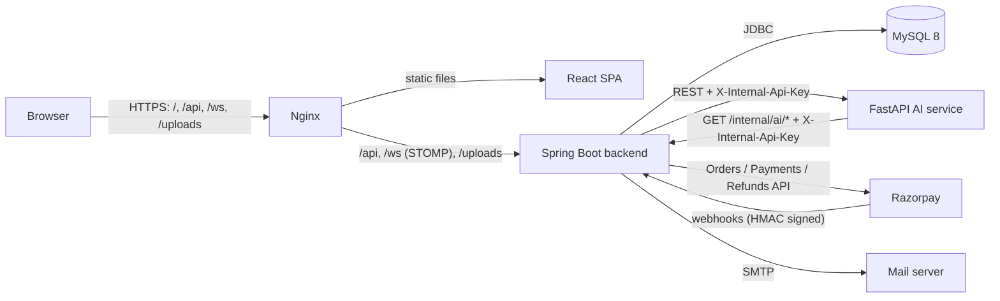
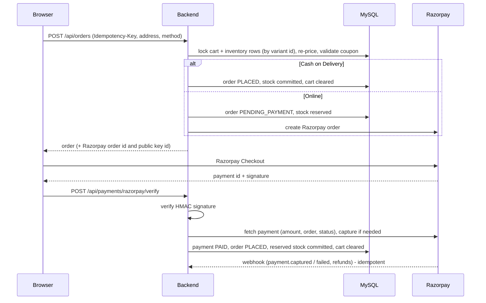

# Architecture

ShopSmart is three deployable services plus MySQL:

- **Backend** (the system of record): all business rules, persistence, authentication,
  payments, real-time pushes, e-mails, analytics.
- **AI service** (stateless, optional): builds an in-memory product index from the backend's
  catalog every two minutes and answers ranking, recommendation and forecasting requests. When it
  is down, the backend falls back to keyword ranking and rule-based recommendations, so shopping
  never depends on it.
- **Frontend**: a single-page app served by Nginx, which also reverse-proxies the API, WebSocket
  and uploads so the browser talks to a single origin (no CORS in production).

## Backend

A modular monolith with one package per domain under `com.shopsmart`: `auth`, `user`, `security`,
`product`, `category`, `brand`, `inventory`, `cart`, `wishlist`, `coupon`, `pricing`, `order`,
`payment`, `review`, `search`, `recommendation`, `activity`, `analytics`, `notification`,
`realtime`, `storage`, `admin`, `ai`, `seed`, `common`, `config`. Controllers are thin; services
own transactions; DTOs are Java records; JPA entities never leave the service layer.

### Checkout and payment

- **The server decides every amount.** The browser sends only what it wants (items via the cart,
  address, payment method); prices, discounts, coupon value, GST and shipping are computed by
  `PricingService` inside the checkout transaction, and the Razorpay order is created for that
  total.
- **Stock is correct under concurrency.** Checkout locks inventory rows with
  `SELECT ... FOR UPDATE` in variant-id order (no deadlocks), and database CHECK constraints
  (`reserved <= quantity`, `quantity >= 0`) are the last line of defence. Online orders reserve
  stock; payment commits it; cancellation or expiry releases it.
- **No duplicate orders.** An `Idempotency-Key` per checkout attempt is stored on the order
  (unique per user); a retry returns the original order. An unpaid online order with the same
  items, address and coupon is reused instead of reserving stock twice.
- **Payment state is never trusted from the client.** Verification requires a valid HMAC
  signature and the payment as reported by Razorpay's API. Webhooks are verified with the webhook
  secret and de-duplicated by event id. `PaymentReconciliationJob` (every 5 minutes) settles or
  expires unpaid orders after checking Razorpay, captures lingering authorisations and retries
  failed refunds.
- Order status follows an explicit state machine:
  `PENDING_PAYMENT -> PLACED -> CONFIRMED -> PROCESSING -> SHIPPED -> OUT_FOR_DELIVERY -> DELIVERED`,
  with `CANCELLED` possible until shipping. Every change is written to `order_status_history`.

### Events, notifications and real time

Services publish domain events (`OrderPlacedEvent`, `OrderStatusChangedEvent`,
`PaymentSucceededEvent`, `LowStockEvent`, ...). Listeners run **after the transaction commits**
(in their own transaction), so nothing is announced that could still roll back. They:

1. store in-app notifications,
2. push STOMP messages: `/topic/orders/{id}`, the owner's `/user/queue/orders` and
   `/user/queue/notifications`, and `/topic/admin/orders` / `/topic/admin/inventory`,
3. send e-mails (verification, password reset, order placed, payment, shipping, delivery,
   cancellation).

WebSocket connections authenticate with the access token in the STOMP `CONNECT` frame; every
`SUBSCRIBE` is authorised (a customer can only follow their own orders; admin topics require the
admin role). Clients treat pushes as signals to refetch, and fall back to polling while
disconnected, so a missed message never leaves stale data on screen.

### Smart search

1. `SearchQueryParser` extracts price bounds ("under 5k", "between 10k and 20k"), minimum rating,
   stock intent, brand, category, features ("wireless", "anc") and use cases ("gaming",
   "travel"). A category named in the query is a hard filter; one only implied by wording
   ("earbuds" suggests audio) is a preference.
2. The database returns candidates that satisfy the hard filters (relaxed if nothing matches).
3. The AI service ranks candidates by embedding similarity to the remaining text.
4. The backend blends semantic score, keyword match, feature/use-case matches, popularity and
   rating; products outside an implied category are down-weighted rather than removed.

Every search is recorded (search history and, for signed-in users, activity) and feeds
recommendations.

### Recommendations

The AI service combines, per user:
- long-term interest: similarity to products the user engaged with, weighted by event type
  (purchase > cart/wishlist > review > view) and decayed with a 14-day half-life,
- short-term intent: similarity to what they engaged with in the last 48 hours,
- item-to-item collaborative filtering from all customers' interactions,
- their recent searches and overall popularity.

Each item carries a reason ("Because you recently viewed ...", "Customers with similar taste
bought this"). Results are cached per user in `recommendations` and invalidated by new activity.
Without the AI service the backend recommends by category/brand affinity plus trending products.

### Analytics and forecasting

Analytics are SQL aggregates over orders, order items, views and customers, bucketed by day in
IST. Unpaid and cancelled orders are excluded from revenue. Insights come in two clearly
separated kinds: **historical** observations computed from the data, and **predictions** from the
AI service's forecasting model (recency-weighted linear trend on weekly sales with an 80%
prediction interval and a backtest error), which reports `INSUFFICIENT_DATA` rather than
guessing for products with little history.

## Frontend

- Feature folders under `src/features` (catalog, search, cart, checkout, orders, account, admin,
  ...); shared UI primitives under `src/components`; infrastructure under `src/lib`.
- Routing: React Router data router with a code-split route per page; the admin console and
  charting library are only downloaded by administrators.
- Server state: TanStack Query. User-specific data lives under `['me', ...]` and admin data under
  `['admin', ...]`; both are dropped whenever the signed-in user changes.
- Session: the access token is kept in memory only (never `localStorage`); a single-flight
  refresh exchanges the HttpOnly refresh cookie for a new token shortly before expiry and on
  `401 INVALID_TOKEN`. Sign-in and sign-out are broadcast to other tabs.
- Real time: one STOMP connection per tab with exponential reconnect; pushes invalidate queries.
- Forms: React Hook Form + Zod mirroring the backend's validation; server field errors are mapped
  back onto the form.

## Background jobs

| Job | Schedule | Purpose |
| --- | --- | --- |
| `PaymentReconciliationJob` | every 5 min | settle/expire unpaid online orders, capture authorisations, retry refunds |
| `TokenCleanupJob` | daily 03:17 | purge expired refresh and single-use tokens |
| AI catalog refresh | every 2 min (AI service) | rebuild the product index and interaction matrix |

## Design limits

- Single backend instance: the simple STOMP broker and the Bucket4j rate-limit buckets live in
  memory. Scaling out needs an external broker relay (RabbitMQ/ActiveMQ STOMP) and a shared
  bucket store (Redis/JCache). Scheduled jobs are idempotent and safe to run on several instances.
- Uploaded files are on the local disk (`UPLOAD_DIR`); multi-instance deployments need shared or
  object storage behind `StorageService`.
