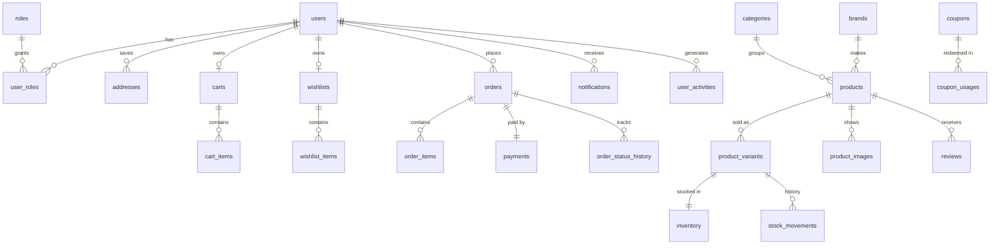

# Database

MySQL 8 (InnoDB, `utf8mb4`). The schema is created and evolved by Flyway
(`backend/src/main/resources/db/migration`); Hibernate only validates it.

## Conventions

- `BIGINT AUTO_INCREMENT` surrogate keys; natural keys (e-mail, slug, SKU, order number, coupon
  code) have unique constraints.
- Timestamps are `DATETIME(6)` in **UTC** (the JDBC session time zone is forced to UTC); reports
  convert to IST for day buckets.
- Money is `DECIMAL(12,2)` in INR; tax rates are fractions (`0.1800`).
- Enumerations are stored as `VARCHAR` names (for example `PENDING_PAYMENT`).
- Every foreign key, unique key, check constraint and index is named explicitly.
- Tables with concurrent writers carry a `version` column for optimistic locking
  (`products`, `inventory`, `coupons`, `orders`, `payments`); checkout additionally takes row locks.

## Entity overview

## Tables

### Identity and access

| Table | Purpose |
| --- | --- |
| `users` | accounts: e-mail (unique), BCrypt hash, name, phone, status (`ACTIVE`/`DISABLED`), e-mail verification time, failed sign-in counter and lock time, last sign-in |
| `roles`, `user_roles` | `CUSTOMER`, `ADMIN` |
| `refresh_tokens` | SHA-256 **hashes** of refresh tokens with a family id for rotation and reuse detection; expiry, revocation, IP and user agent |
| `user_tokens` | hashed single-use tokens for e-mail verification and password reset |
| `addresses` | saved delivery addresses (Indian PIN codes), one default per user |

### Catalog

| Table | Purpose |
| --- | --- |
| `categories`, `brands` | unique name and slug, active flag |
| `products` | list price (MRP) and `discount_percent` (0-95); status `DRAFT/ACTIVE/INACTIVE/ARCHIVED`; `featured` |
| `product_variants` | the sellable SKUs (globally unique), optional `price_override`, active flag. Every product has at least one |
| `product_variant_attributes` | name/value options per variant (Colour: Black) |
| `product_tags`, `product_specifications` | search tags; ordered name/value specification rows |
| `product_images` | URL, thumbnail, alt text, order, storage key and dimensions (binaries live in `UPLOAD_DIR`) |
| `inventory` | per variant: `quantity` on hand, `reserved` for unpaid online orders, low-stock threshold. `CHECK (quantity >= 0 AND reserved <= quantity)` |
| `stock_movements` | every inventory change: type (restock, adjustment, reservation, sale, release, ...), deltas, resulting values, order and actor |

**Derived columns** maintained by the application (so listings can filter and sort with indexes):
`products.sale_price` (lowest effective selling price across active variants),
`products.search_text` (lower-cased keyword document), `products.average_rating` and
`review_count` (from published reviews), `products.sold_count` (from placed orders).

### Shopping

| Table | Purpose |
| --- | --- |
| `carts`, `cart_items` | one cart per user; unique (cart, variant); quantity > 0; applied coupon code |
| `wishlists`, `wishlist_items` | one wishlist per user; unique (wishlist, product) |
| `coupons` | percentage or fixed discounts with minimum order, cap, validity window, total and per-user limits, `used_count` |
| `coupon_usages` | one row per order that used a coupon (unique by order) |

### Orders and payments

| Table | Purpose |
| --- | --- |
| `orders` | order number (unique), status, payment method, the full price breakdown as charged (MRP total, subtotal, coupon, shipping, tax rate/inclusive/amount, total), a **snapshot of the delivery address**, note, `idempotency_key` (unique per user), estimated delivery, placed/delivered/cancelled times |
| `order_items` | snapshot of product name, variant, SKU, image and prices at purchase time, so catalog edits never change past orders |
| `order_status_history` | every status transition with actor and note |
| `payments` | one per order: method, status (`PENDING, AUTHORIZED, PAID, FAILED, REFUNDED, CANCELLED`), amount, Razorpay order/payment ids (unique), provider method, failure reason, refund id/amount, COD collector |
| `payment_events` | processed Razorpay webhook events, unique (provider, event id), which makes webhook handling idempotent |

### Engagement and analytics

| Table | Purpose |
| --- | --- |
| `reviews` | one per user and product, rating 1-5, `PUBLISHED`/`HIDDEN`, moderation note |
| `notifications` | in-app notifications with read time and link |
| `search_history` | every search (anonymous too) with normalised query, type and result count |
| `product_views` | every product page view (anonymous too) for popularity and conversion |
| `user_activities` | signed-in users' events (view, search, cart, wishlist, purchase, review, category view) feeding recommendations |
| `recommendations` | cached personalised recommendations per user (score, reason, algorithm) |

### Administration

| Table | Purpose |
| --- | --- |
| `store_settings` | single row (`CHECK id = 1`): store name, support e-mail, GST rate and inclusion, shipping fee and free-shipping threshold, default low-stock threshold, COD enabled and limit, online payments enabled, unpaid-order hold time |
| `audit_logs` | who did what to which entity, from which IP, when |

## Integrity and concurrency

- Checkout locks the cart, the relevant inventory rows (in variant-id order) and the coupon row,
  re-validates prices and stock, then writes the order, items, payment, stock movements and
  coupon usage in one transaction.
- Counters such as `sold_count`, `used_count` and ratings are updated with targeted `UPDATE`
  statements rather than read-modify-write, so concurrent orders never lose increments.
- Deletion rules: user data cascades on account deletion; orders keep references to products and
  variants (`RESTRICT`), which is why products are archived rather than deleted.

## Seed data (dev profile)

Created only when the catalog is empty and never in `prod`: 10 categories, 15 brands, 61 products
(79 variants, 103 images), 5 coupons, an admin and 15 customers, and 120 days of orders, reviews,
product views, searches and activities generated with a fixed random seed.

## Maintenance

- Add a new migration (`V2__description.sql`) for every schema change; never edit an applied
  one. Prefer additive, backward-compatible changes (add column → backfill → switch reads).
- `TokenCleanupJob` purges expired tokens daily. Behavioural tables (`product_views`,
  `search_history`, `user_activities`) grow with traffic; archive or partition by month when
  they get large.
